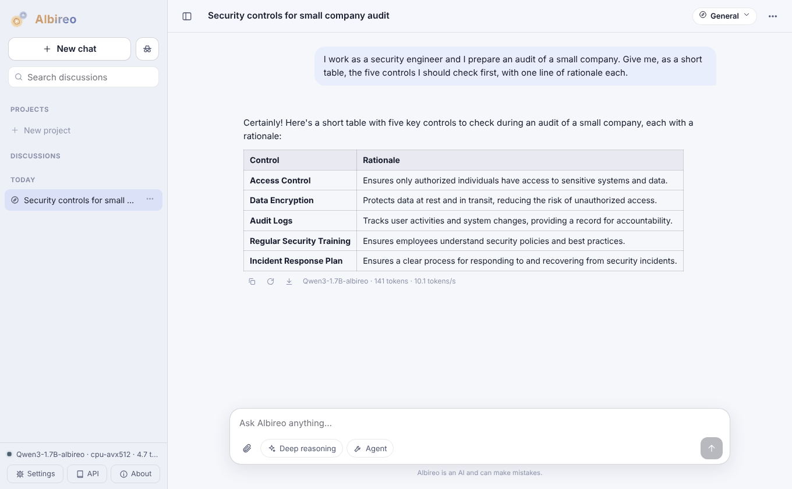
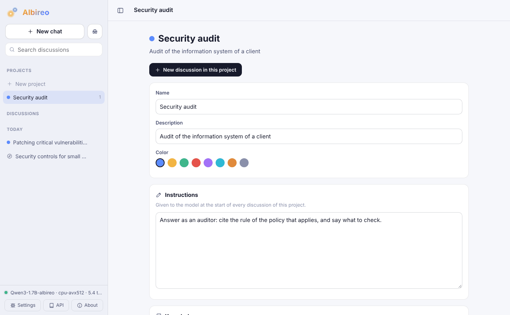
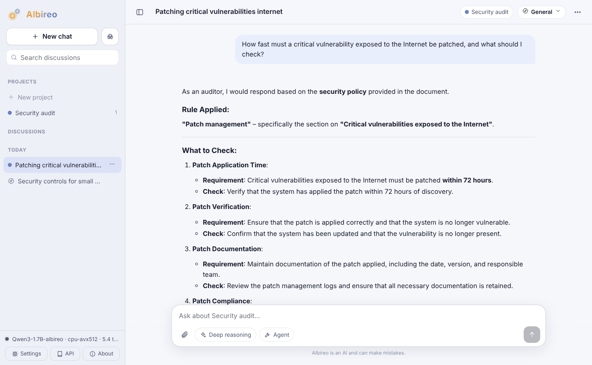
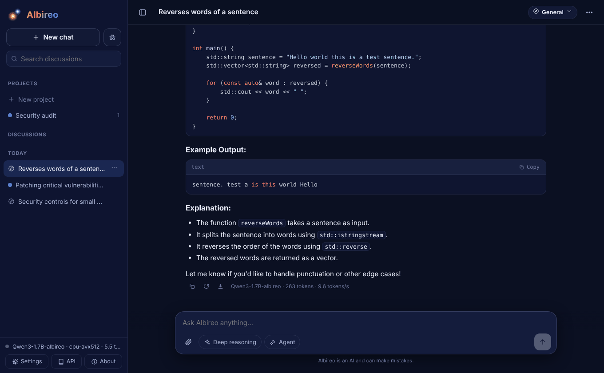
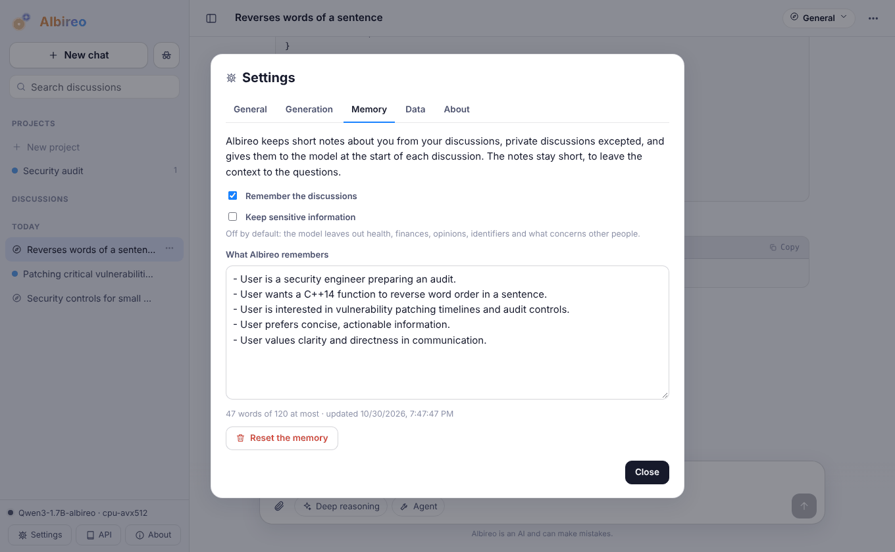
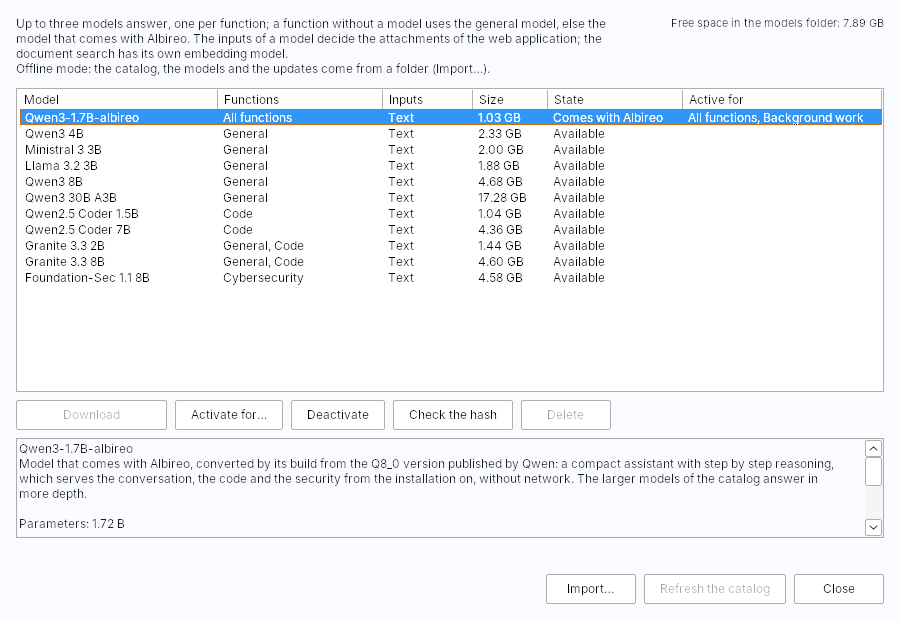
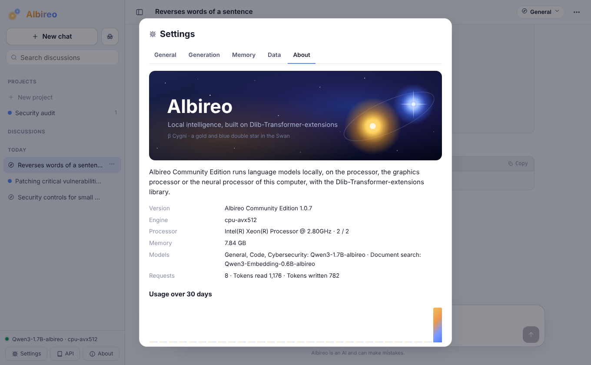
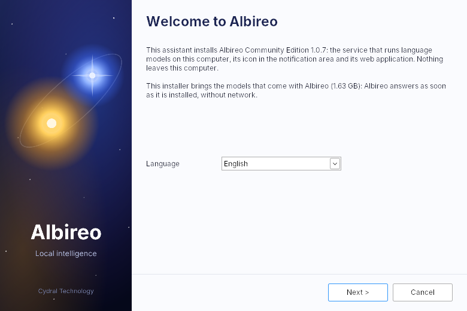
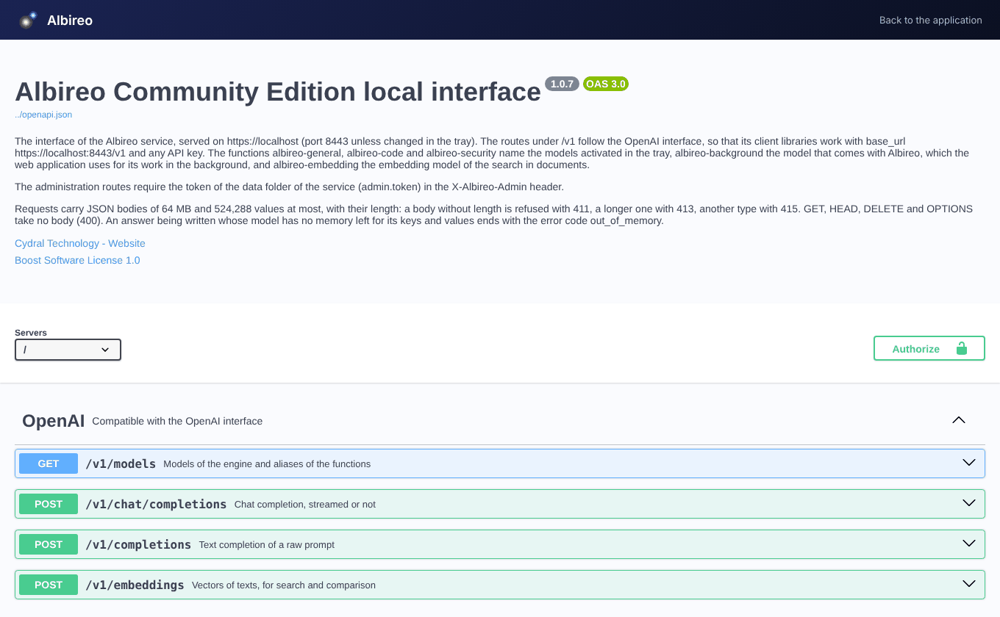

# Albireo

Albireo runs language models on the computer where it is installed. It is a Windows 11
program built on dlib and Dlib-Transformer-extensions: an inference engine for quantized GGUF
models, a Windows service that serves it on a local HTTPS address with an interface compatible
with the OpenAI one, a web application served by that service, an icon in the notification area
to manage it, and an installer. The conversations, the documents and the models stay on the
machine, and nothing asks for an account.



Albireo is published by Cydral Technology and was created by Aldric Pierrain. Its name is that
of a double star of the constellation Cygnus, one gold and one blue, which its icon draws. This
version is the Community Edition: the installer, the About windows of the icon and of the web
application, the description of the interface and the list of the programs of Windows name it
"Albireo Community Edition".

## Contents

- [What it does](#what-it-does)
- [Screenshots](#screenshots)
- [How it is built](#how-it-is-built)
- [Source tree](#source-tree)
- [Building on Windows](#building-on-windows)
- [Building on Linux](#building-on-linux)
- [Tests](#tests)
- [Installation](#installation)
- [Settings](#settings)
- [Interfaces](#interfaces)
- [Models](#models)
- [Models that come with Albireo](#models-that-come-with-albireo)
- [Computers without network](#computers-without-network)
- [Publishing a version](#publishing-a-version)
- [Security](#security)
- [Data folders](#data-folders)

## What it does

- **Chat** in the web application, with the discussions kept in the browser (IndexedDB), an
  incognito mode that keeps them in memory only, a search over the discussions, and the reasoning
  of the models that reason shown while they think, then folded once the answer starts.
- **Documents** attached to a message or to a project: Word, Excel, PowerPoint, OpenDocument,
  PDF, RTF, HTML, text, CSV, Markdown and source code. The browser extracts the text of every page
  of a document, of every sheet of a workbook in the order of its tabs, and of every slide of a
  presentation in the order of the show. Each file appears as a thumbnail with its format, which
  can be removed before sending, and the edition of a question keeps, removes or adds its files.
- **Projects**: discussions grouped with instructions and documents that form their shared
  context, read whole when they fit, searched otherwise by meaning and by words, the search and
  its index running in the browser (see [Documents and context](#documents-and-context)).
- **Three functions**, general, code and security, each served by a language model of the
  catalog, chosen in the Models window or by the service when a model arrives, and an embedding
  model for the search in documents, which the service installs in every case.
- **Models that come with Albireo**: the complete installer carries Qwen3-1.7B-albireo, which
  serves the three functions as soon as Albireo is installed, and Qwen3-Embedding-0.6B-albireo
  for the search, both retrieved and converted by the build (see
  [Models that come with Albireo](#models-that-come-with-albireo)).
- **Agent mode**: the model calls tools that run in the page (calculator, JavaScript in a
  sandboxed frame, outline, reading and search of the documents), up to eight steps per answer.
- **Several conversations at once**: the requests of every client are computed together, one
  forward pass serving the next token of each, and the keys and values of a finished request stay
  cached so that the next turn of a conversation starts where the previous one ended.
- **An interface for other programs**: `/v1/chat/completions`, `/v1/completions`,
  `/v1/embeddings` and `/v1/models` follow the OpenAI interface, streaming included, with its
  documentation as a Swagger page at `/docs/`.
- **Engines for each kind of processor**: portable, AVX2, AVX-VNNI, AVX-512, Intel NPU and
  integrated GPU through OpenVINO, NVIDIA GPU through CUDA, behind a single C interface. The
  service measures them on the machine and runs the fastest, and the icon menu can force the NPU,
  the GPU or both while a processor engine runs.
- **Models from a signed catalog**, downloaded in parallel parts, checked against their hashes,
  or imported from a disk or a memory card.
- **Updates** announced by a signed feed, attached to the GitHub releases of the repository,
  downloaded in the background and installed when the service restarts.
- **An offline mode** for the computers without network: the service opens no connection, and
  the catalog, the models and the updates come from an offline bundle brought on a disk.
- **Five languages** in every window: English, French, German, Italian and Spanish, the language
  of Windows by default.

## Screenshots

The web application served by the service, the windows of the icon and the installer, with the
model that comes with Albireo (Qwen3-1.7B-albireo) on a processor of two cores.

| | |
|---|---|
|  |  |
| A project: its instructions, its documents and its discussions | A discussion of the project, which cites the policy given as a document |
|  |  |
| Code, in the dark theme | The memory of the discussions, written in the background |
|  |  |
| The Models window of the icon | Version, engine, processor and use of the service |
|  |  |
| The installer, which carries the models | The documentation of the interface, at `/docs/` |

## How it is built

### Engines

An engine is a library (`engines\albireo-engine-<variant>.dll`) that exports the functions of
[`common/engine_api.h`](common/engine_api.h): describe, create, load and unload a model, submit a
request whose tokens come back as events, cancel it, and answer queries (statistics, tokens,
models). Every variant is built from the same sources:

| Variant       | Products with the weights                                             | Built with                   |
|---------------|-----------------------------------------------------------------------|------------------------------|
| `cpu`         | quantized kernels, every x86-64 processor                             | the main build tree          |
| `cpu-avx2`    | quantized kernels, AVX2, FMA and F16C (Intel Haswell, AMD Zen and later) | the main build tree       |
| `cpu-avxvnni` | `cpu-avx2` with the dot products of AVX-VNNI (Intel Core from Alder Lake on, AMD Zen 5) | the main build tree |
| `cpu-avx512`  | AVX-512 F, BW, DQ and VL with VNNI (Intel Xeon from Cascade Lake on, Intel Core Ice Lake, Tiger Lake and Rocket Lake, AMD Zen 4 and later) | the main build tree |
| `openvino`    | NPU and integrated GPU of Intel processors, kernels of `cpu-avx2`     | `ALBIREO_ENGINE_OPENVINO=ON` |
| `openvino-avxvnni` | `openvino` with the kernels of `cpu-avxvnni`                     | `ALBIREO_ENGINE_OPENVINO=ON` |
| `openvino-avx512`  | `openvino` with the kernels of `cpu-avx512`                      | `ALBIREO_ENGINE_OPENVINO=ON` |
| `cuda`        | NVIDIA graphics processors, AVX2 kernels                              | `ALBIREO_ENGINE_CUDA=ON`     |

The half precision conversions of F16C belong to `cpu-avx2`: every processor with AVX2 has them,
and the keys and values of the attention, kept in half precision, go through them. The variants
differ in their quantized kernels only ([`engine/qkernels.cpp`](engine/qkernels.cpp)), compiled for
the instructions of each variant (`/arch:AVX2`, `/arch:AVX512` with Visual Studio; `-mavxvnni`,
`-mavx512f -mavx512bw -mavx512dq -mavx512vl -mavx512vnni` with GCC and Clang) while the rest of the
library stays at AVX2: the description of a library runs on any processor with AVX2 and reports the
instructions the processor lacks, so that the service passes to the next variant. VNNI adds up four
products of bytes, or two products of 16-bit integers, in one instruction (`vpdpbusd`,
`vpdpwssd`): the kernels of Q4_0 and Q8_0 take the offsets of their weights from the sums of the
activations, those of Q4_K, Q5_K and Q6_K apply their scales with `vpdpwssd`, and the AVX-512
kernels take two blocks, or two sub-blocks of a super-block, per vector, with the products of the
prompts on 512-bit vectors. The AVX-VNNI intrinsics need Visual Studio 2022 (GCC 11, Clang 12);
an older compiler builds the other variants.

The products the NPU or the graphics processor does not take, and every product the routing of
dlib leaves to the processor, run on the quantized kernels of the engine. The OpenVINO engine is
therefore built once per family of kernels, so that a processor with AVX-VNNI or AVX-512 keeps its
kernels when the NPU or the GPU serves the models. The service describes the OpenVINO engine of the
richest family the processor runs and offers its devices (`openvino:npu`, `openvino:gpu`,
`openvino:both`); the setting `"engine": "openvino"` names that engine. A library whose kernels
need instructions the processor lacks is reported as such without being loaded, since the runtime
of a device takes seconds to start.

The forward pass ([`engine/cpu_runtime.cpp`](engine/cpu_runtime.cpp)) keeps the weights in the
memory mapping of the GGUF file, in their quantized form, and multiplies them with kernels that
quantize the activations to 8 bits per block, so that a generated token reads each weight once.
The keys and values live in half precision in pages of 256 positions, one sequence per request;
the conversations that start with the same text share the full pages of that text, and a sequence
copies a shared page before writing in it.
The attention runs on the processor in every variant, by tiles: up to 64 rows of queries, the
heads that share one key/value head for consecutive tokens of a prompt, read the pages one after
the other with a running maximum and sum, as FlashAttention does, so that each key and value
taken from memory serves the whole tile instead of a single row. On two cores, the 2,900 tokens
of a question that a project adds to a discussion of 3,200 tokens took 80 s instead of 228 s with
Qwen3 0.6B. While a single answer is generated, each head makes a task of its own, so that every
thread takes part. The scheduler ([`engine/engine.cpp`](engine/engine.cpp)) builds each pass from
the next token of every request being generated and a slice of the prompts being read, and draws
the next tokens of the pass in parallel. When the pages run out, a prompt being read gives its
pages back to the answers being written and is read again once there is room; the context of a
model never exceeds the positions its pages can hold, so a prompt the engine accepts can always
be read to its end.

The engines of the devices add a `matmul_offload` ([`engine/offload.h`](engine/offload.h)) that
receives each product with the way to compute it on the processor
([`engine/tensor_backend.cpp`](engine/tensor_backend.cpp)). The product goes to the device through
the tensors of dlib, with a copy of the weight matrix in single precision kept while the copies of
all the models fit in a budget:

- with OpenVINO, the routing of the NPU module of dlib times the processor kernels against the NPU
  and the GPU, shape by shape, and keeps the faster;
- with CUDA, the engine makes these measures itself, on two matrices of each shape, and checks its
  choice at growing intervals; the extended device memory of dlib (V²RAM) lets the copies exceed
  the memory of the card, the blocks that do not fit moving to the memory of the host or to a file
  and coming back ahead of their use.

The products of a single token often stay on the processor, which serves them from the compact
weights; the products of the prompts go to the device.

The models loaded together share the budget of the device (`device_mb`, automatic by default:
80 % of the free memory of the card, or the card and the extended memory with V²RAM, a quarter of
the memory of the host with OpenVINO). A model with requests in progress or waiting keeps its
copies. When it needs room, the models without requests give theirs, the least recently used model
first, each giving the room asked and keeping its other copies; those copies come back when their
model answers again. The embedding model takes part like the language models: while no document is
being indexed or searched, its room goes to the models that answer. When every model has requests
and the budget is full, a matrix without room is expanded at each product (CUDA) or computed by the
processor, so that the requests of all the models go on together. The statistics of the device
count the copies that left (`evictions`, `evicted_bytes`).

A model replaced or deactivated in the Models window leaves the engine once its requests are served
(`engine_host::unload_model`): from that moment the service routes no new request to it, the
requests in progress and waiting end normally, possibly computed together with those of the other
models, and the model is unloaded after the last one (the requests still running after 30 minutes
end with the unloading). The window shows it as unloading meanwhile; activated again before it
leaves, the model stays loaded. A model deleted while it answers is deleted the same way, once its
requests are served, and is shown as being deleted until then.

### Service

`albireo-service.exe` runs as the Windows service `Albireo` (LocalSystem, delayed automatic start)
and, for development, in a console with `--console`. It:

- describes each engine library in a child process (`--probe-engine`), so that a library that
  cannot load leaves the service running, and measures them the same way (`--bench-engine`);
- starts the chosen engine and the active models, and serves `https://localhost:<port>/` with
  cpp-httplib and Mbed TLS, with a certificate issued by its own authority, which the installer adds
  to the trusted roots of the machine;
- keeps its settings in `settings.json`, the models, the downloads and the usage in an SQLite
  database, and its log in `logs\service.log`;
- restarts itself when a setting requires it, in a new process once the engine of a device has
  run, since that library stays loaded with the threads of its runtime.

The server answers as soon as its port is open: the engines are described and the chosen one
starts in the background, then the active models load. Until then `/api/status` gives the state
`starting` with the step in progress (`engines`, then `models`), the requests for a model answer
503 with the code `starting` or `model_loading` and a `Retry-After` header, and the web application
says that the service is starting. A slow computer, after an installation or at the start of the
session, thus shows a start in progress instead of a failure.

### Tray, installer and web application

`albireo-tray.exe` places the icon in the notification area and opens the windows of the models,
of the computer (processor, engine, extended memory with its usage, models folder, port, language,
proxy) and of the product. While the service does not answer, the icon reads its state in the
Service Control Manager: a service starting, or a delayed automatic start that has not come yet
at the opening of the session, shows the icon of a start in progress, and the icon warns that the
service does not answer, once per episode, only after a grace period adapted to that state: 10
minutes for a service in its start, 5 minutes for a running service that has not answered yet, 15
minutes for a delayed automatic start during the first 15 minutes after the boot, 2 minutes for a
service that stops, 30 seconds for a service that answered before, one minute for a stopped
service. The application opened
from the icon during a start opens once the service answers. The service gives its errors with a code and its values
([`host/user_error.h`](host/user_error.h)), and the engines the reasons for which they cannot run
(`reason_code`), which the windows explain in the language of the interface; a default model
that could not be downloaded shows its download in error, with the reason, in the Models window.
The settings of the extended memory apply to the CUDA engine and are grayed without it, and the
Accelerator menu says why it offers no choice: no engine of a device installed, or none that runs
on this computer. `albireo-setup.exe` carries the programs as a ZIP payload, installs them
with a wizard or silently, registers the service and the entry of Apps & Features, and removes them.
The web application ([`web/`](web)) is plain ES modules with its libraries in
[`web/vendor`](web/vendor), served by the service with a content security policy that allows no
other origin.

### Documents and context

The text of a document is extracted in the browser ([`web/js/documents.js`](web/js/documents.js)):
the Office and OpenDocument formats are ZIP archives of XML, read with the decompression of the
browser within 256 MiB of extracted XML per document (an entry that expands more than 200 times
is refused), and PDF goes through pdf.js. The text marks each page, slide and sheet with a line that
starts with `## `, which names the passages of the search and lets the tools of the agent read a
document part by part. Nothing leaves the browser but the text placed in the messages.

The search ([`web/js/rag.js`](web/js/rag.js)) cuts the documents into passages of 1,200
characters overlapping by 240, named after their document and their part. The embedding model of
the service computes the vector of each passage once, through `/v1/embeddings`, and the passages
are kept with their vectors in the database of the browser (IndexedDB), or in memory for an
incognito discussion. A question is compared with the passages by meaning (cosine of the vectors)
and by words (BM25); the two rankings are fused (reciprocal rank fusion), the passages chosen so
that they do not repeat each other (maximal marginal relevance), and the consecutive passages of
a document merged into one excerpt. The engine computes the vectors of every client in the same
passes and keeps these passes short while a conversation is answered, so that indexing documents
never delays an answer.

The prompt of a question is built for the cache of the engine, which keeps the keys and values of
each conversation and computes again only the tokens that differ from what it already read
([`web/js/app.js`](web/js/app.js)):

| Part of the prompt | Content | Share of the context |
|---|---|---|
| System message | date, instructions, memory, documents of the project read whole | 30% at most, else the project is searched |
| Memory | short notes on the user, as they were when the discussion started | 4% at most, 120 words |
| Summary | the exchanges that left the context, compressed by the model | 15% at most |
| Attached document | read whole | 25% at most, else indexed and searched |
| Excerpts of a question | the passages found for it, kept with the message once sent | 20% at most |
| Exchanges | the conversation | the rest; the oldest leave in one step, down to 60% of the room |

The beginning of the prompt therefore stays the same from one question to the next: each question
costs its own tokens only, the conversations of a project share the reading of its documents
(the engine shares the pages of the cached prefix between the sequences), and the cut of the oldest
exchanges happens once every several questions. The service serves several sessions at once,
each with its own context: the requests of every session are computed together, one forward pass
serving the next token of each.

A discussion has no length limit. Once an answer fills 80% of the room of the context, the
oldest exchanges are compressed in the background: the background model rewrites the summary of
the discussion with them, in parts that fit its context, oldest first, keeping the facts, figures, names, decisions,
requests and open questions, and the discussion then starts with the summary, given with its
first remaining question. A question that comes before the summary waits for it; a summary that
cannot be written lets the exchanges leave without it. When the last question alone does not fit,
the oldest texts lose their beginnings, at the end of a sentence: the summary first, then the
documents and the texts of the questions. A question deleted from a discussion leaves with its
answer and the documents attached to it; when it was already compressed, the summary is written
again without it.

The work the application does in the background, the titles, the summaries and the memory, goes
to the background model: the model that comes with Albireo (`albireo-background`), which the
service keeps loaded whatever the functions, without reasoning; without it, the general model
serves it.

The memory of the discussions holds short notes on the user (profession, projects, preferences,
the way to answer). It reads the questions it has not read yet, each discussion from its mark, in
one pass once they are enough (three questions or 1,200 characters) and the user has been quiet
for 20 seconds, at the opening of the application included: the background model writes the new
facts only, in the language of the interface, which join the memory unless it holds them already
in other words, and the memory is rewritten as a whole only when it outgrows its size (120 words),
or else loses its oldest lines.
A notification, which disappears by itself, says how many facts joined, and a new question stops
an update in progress, which comes back once the user is quiet again. One tab updates the memory
at a time, by a lease of three minutes in the database of the browser: a tab closed in the middle
of an update holds nothing, the service stops the request within two seconds, and the next update
reads the same questions again, since the marks move only once the memory is saved. The tabs tell
each other the changes of the settings; an update reads the memory again before saving it and
drops its result when another tab edited, reset or turned off the memory meanwhile. The notes
leave out sensitive information (health, finances, opinions, identifiers, other people) unless
the settings keep it, and the lines that hold a password, a key or a payment number never enter
the memory unless they do. A discussion receives the memory as it was when it started, so that its
prompt keeps the same beginning; the private discussions neither read nor feed it. The settings
show the memory, let the user edit it, turn it off and reset it. The background model also names
each discussion from its first question, unless the user renames it.

The lists of the side panel show the 20 most recent projects and discussions; the search window
of each finds the others, the words in any case and accents, complete or not, in the titles first,
then in the content (questions, answers, descriptions, instructions and documents of the projects),
and shows where it found them. Each answer exports to Markdown or JSON with its question, as the
whole discussion does. The interface takes the language of Albireo, set in the window of the
computer, unless its own settings choose another.

## Source tree

| Folder                   | Content                                                                      |
|--------------------------|------------------------------------------------------------------------------|
| [`engine/`](engine)      | the inference engine: runtime, kernels, scheduler, chat formats, devices      |
| [`host/`](host)          | the service: server, settings, store, models, updates, certificates           |
| [`common/`](common)      | the C interface of the engines, JSON, logs, platform and processor details    |
| [`windows/`](windows)    | the tray, the installer, their windows and their texts in five languages      |
| [`web/`](web)            | the web application, the Swagger page and the OpenAPI description            |
| [`resources/`](resources)| icons, images, license, version resources, models that come with Albireo      |
| [`cmake/`](cmake)        | MinGW-w64 toolchain, payload of the installer, runtime libraries of devices, downloads of the models |
| [`tests/`](tests)        | kernel, runtime, tokenizer and device tests, engine driver, benchmark          |
| [`tools/`](tools)        | build and test scripts, preparation of the models that come with Albireo, catalog, feed, publication, offline bundle, images |

## Building on Windows

Requirements: Visual Studio 2022, or the Build Tools for Visual Studio 2022, with the C++ workload,
and CMake 3.21 or later (the C++ CMake tools of the workload serve, the script finds them outside
the PATH), and about 6 GB of free space for the models that come with Albireo, their cache and the
complete installer. The OpenVINO engines need the runtime of OpenVINO (`python -m pip install openvino`, or
the archive with `INTEL_OPENVINO_DIR` set); the CUDA engine needs the CUDA toolkit 12.8 or later
and cuDNN 9. Without Visual Studio, the installer of the CUDA toolkit adds its integration to the
Build Tools.

dlib is configured for one device per build tree, so the engines of the devices are built in their
own trees and join the installer through `ALBIREO_EXTRA_ENGINE_DIRS`. The script
[`tools/build_windows.ps1`](tools/build_windows.ps1) runs the whole sequence from the root of the
repository:

```
powershell -ExecutionPolicy Bypass -File dlib\dlib\external\albireo\tools\build_windows.ps1 -Cuda
```

The OpenVINO engines are built by default, so that every installation reaches the NPU and the
graphics processor of an Intel machine; the script stops with a message when the runtime of
OpenVINO is missing, and `-NoOpenVINO` builds without these engines (`-OpenVINO`, which earlier
versions required, is still accepted). The CUDA engine stays optional: on a machine with a
supported NVIDIA card, the service prefers it, since the card takes every product. A build tree
configured by a Visual Studio installation removed since, such as Visual Studio Community
replaced by the Build Tools, is deleted and configured again. `-NoBuiltinModels` builds without
the models that come with Albireo and `-ModelCache <folder>` puts their cache on another drive.
`-Tests` adds the test programs, `-Jobs <n>` bounds the compilations run at once on a machine with
little memory, `-CudaVersion 12.9` picks one of several installed CUDA toolkits, `-Cudnn <folder>`
one cuDNN installation (`C:\Program Files\NVIDIA\CUDNN\v9.11` for instance), and
`-CudaArchitectures` replaces the list of architectures of the CUDA engine. The script amounts to:

```
cmake -S dlib/dlib/external/albireo -B build-albireo-ov -G "Visual Studio 17 2022" -A x64 -DALBIREO_PROGRAMS=OFF -DALBIREO_ENGINE_OPENVINO=ON
cmake --build build-albireo-ov --config Release
cmake -S dlib/dlib/external/albireo -B build-albireo-cuda -G "Visual Studio 17 2022" -A x64 -DALBIREO_PROGRAMS=OFF -DALBIREO_ENGINE_CUDA=ON
cmake --build build-albireo-cuda --config Release
cmake -S dlib/dlib/external/albireo -B build-albireo -G "Visual Studio 17 2022" -A x64 "-DALBIREO_EXTRA_ENGINE_DIRS=build-albireo-ov/bin/engines;build-albireo-cuda/bin/engines"
cmake --build build-albireo --config Release
```

The installers are `build-albireo\bin\albireo-setup.exe`, complete with the models that come with
Albireo, and `build-albireo\bin\albireo-setup-online.exe`, the one of the updates; the script
prints their size and SHA-256. The device trees copy beside their engine
the libraries it loads (OpenVINO with the plugins of the NPU and of the GPU, or the runtime of CUDA,
cuBLAS and the parts of cuDNN the engine uses, with the Visual C++ runtime) and their licenses,
which the installer places in its `licenses` folder; the same libraries go beside
`tests\test_offload.exe`, with the CPU plugin of OpenVINO for a machine without NPU or Intel
graphics, and the test then runs from its folder. The random numbers and the solvers of
CUDA, which dlib links and the engine never calls, are loaded on first use only and are left out of
the installation.

The CUDA engine carries the machine code of the cards of desktops and laptops from the GeForce GTX
900 series on, and the intermediate code of the newest architecture, which the driver compiles for
the cards that follow:

| Toolkit         | Architectures (`CMAKE_CUDA_ARCHITECTURES`)                             | Cards                         |
|-----------------|------------------------------------------------------------------------|-------------------------------|
| CUDA 12.8, 12.9 | `50-real 61-real 70-real 75-real 86-real 89-real 120-real 120-virtual` | GTX 900, 10, 16, RTX 20 to 50 |
| CUDA 13         | `75-real 86-real 89-real 120-real 120-virtual`                         | GTX 16, RTX 20 to 50          |

cuDNN 9.12 and later run on Turing and later cards only (GTX 16 and RTX series). A build for the
GTX 900 and 10 series therefore takes CUDA 12.8 or 12.9 with cuDNN 9.11 or earlier, the version
copied beside the engine. The configuration prints the toolkit, the cuDNN version and the oldest
compute capability of the result, which the engine also checks at its start: a card below it is
reported as unusable, with its compute capability, and the other engines serve the models.

| CMake option              | Default | Effect                                                            |
|---------------------------|---------|-------------------------------------------------------------------|
| `ALBIREO_PROGRAMS`        | ON      | service, tray, installer, processor engines                       |
| `ALBIREO_ENGINE_OPENVINO` | OFF     | OpenVINO engines (dlib with `DLIB_USE_NPU`), one per family of kernels |
| `ALBIREO_ENGINE_CUDA`     | OFF     | CUDA engine (dlib with `DLIB_USE_CUDA`)                           |
| `ALBIREO_ENGINE_DLIB`     | OFF     | engine whose products go through the host code of dlib (tests)     |
| `ALBIREO_TESTS`           | ON      | test programs, in `<build>/tests`                                 |
| `ALBIREO_EXTRA_ENGINE_DIRS` |       | folders of engines built in other trees, added to the installer   |
| `ALBIREO_COPY_RUNTIME`    | ON on Windows | copy of the runtime libraries beside the device engines      |
| `ALBIREO_BUILTIN_MODELS`  | ON on Windows | models that come with Albireo, in `bin/models` and the complete installer |
| `ALBIREO_MODEL_CACHE`     | user cache | downloaded and converted models that come with Albireo         |
| `ALBIREO_BUILTIN_MANIFEST`| `resources/builtin_models.json` | the models that come with Albireo           |
| `ALBIREO_BUILTIN_TOOL`    |         | `albireo-builtin` of the build machine, for a cross build         |
| `ALBIREO_RUNTIME_LICENSES`|         | more license files for the `licenses` folder                      |

The programs link their C and C++ runtime statically and depend on system libraries only; the
OpenVINO engine uses the shared runtime of OpenVINO's own libraries, installed beside it.

## Building on Linux

The service, the processor engines and the tests build on Linux, which serves for development
(`--console` runs the service in the terminal, `ALBIREO_HOME` names its data folder):

```
cmake -S dlib/dlib/external/albireo -B build-albireo
cmake --build build-albireo -j
ALBIREO_HOME=$HOME/albireo-data build-albireo/bin/albireo-service --console
```

The Windows programs can also be cross-compiled from Linux with MinGW-w64 (POSIX threads), for
the processor engines:

```
cmake -S dlib/dlib/external/albireo -B build-albireo-win -DCMAKE_TOOLCHAIN_FILE=dlib/dlib/external/albireo/cmake/mingw-w64.cmake
cmake --build build-albireo-win -j
```

## Tests

| Program          | Checks                                                                               |
|------------------|--------------------------------------------------------------------------------------|
| `test_qkernels`  | every quantized kernel against its portable version and a reference in floats, and the attention by tiles against a reference in double precision; `test_qkernels_avxvnni` and `test_qkernels_avx512` check the kernels of the other variants, and skip the processors without their instructions, and `test_qkernels_vnni256` (GCC, Clang) runs the 256-bit VNNI kernels through the AVX-512 form of their instructions |
| `test_runtime`   | the logits of a model against `tests/reference_forward.py`, and the same results whatever the cut of the batches |
| `test_tokenizer` | the tokenizer of a GGUF file against reference token sequences                     |
| `test_offload`   | the products of a device against the processor kernels, the small budget path and the measured routing |
| `engine_chat`    | drives an engine library through its C interface: chat, tools, reasoning, parallel requests, embeddings compared with a reference |
| `bench_runtime`  | tokens per second of the prompt and of the generation, also as `bench_runtime_avxvnni` and `bench_runtime_avx512` |

`test_offload model.gguf CPU` validates the OpenVINO engine on a machine without NPU, with the CPU
plugin of OpenVINO; `ALBIREO_ENGINE_DLIB=ON` builds the same test on the host code of dlib.

Two scripts run these programs and the service, then print one line per step with its result:

```
bash dlib/dlib/external/albireo/tools/test_linux.sh
powershell -ExecutionPolicy Bypass -File dlib\dlib\external\albireo\tools\test_windows.ps1
```

They take `~/models/Qwen3-0.6B-Q4_K_M.gguf` and `~/models/Qwen3-Embedding-0.6B-Q8_0.gguf` by
default and skip the steps whose model or build tree is missing. The Linux script runs a service
offline in a data folder of its own, imports the model and asks a question through the OpenAI
interface; the Windows script asks the installed service a question and the vectors of two texts,
and tests the OpenVINO and CUDA engines when their trees exist (`-Device GPU` or `-Device NPU`
for `test_offload`, CPU by default). Their exit code is the number of failed steps.

## Installation

A build gives two installers. `albireo-setup.exe` is complete: it carries the models that come
with Albireo and installs a computer that answers at once, without network. `albireo-setup-online.exe`
is the same program without them: the updates take it, and on a new computer the service
downloads the default models of the catalog.

The wizard asks for the language, the license, the folders of the programs and of the models, the
options (start with Windows, desktop shortcut, trust of the local certificate, download of the
default model, which the complete installer does not need, port), then installs, registers the
service and starts the tray. The command line covers the other cases; the options it does not
give keep the values of the installation in place:

```
albireo-setup /silent [/dir <folder>] [/models <folder>] [/port <port>]
albireo-setup /uninstall [/silent] [/purge]
albireo-setup /models-dir <folder>
albireo-setup /service start|stop|restart
albireo-setup /lang en|fr|de|it|es
```

The installer started from an offline bundle (see [Computers without network](#computers-without-network))
copies into the import folder, which the service reads at its first start, the catalog of the
bundle when it bears the signature of Albireo and the models this catalog lists, each checked
against its hash. The option "This computer has no Internet access" of the wizard, or `/offline`,
sets the service offline from the start.

The folders of the programs and of the models must lie on a local drive; the installer refuses a
drive root, the folders of Windows and of the users, a folder that holds them, a link made by
another account, and a program folder that is neither empty nor an installation of Albireo. It
gives the folders it creates or takes over the rights of the data folder (writing for the
administrators and the service only), and records the files it installs in `albireo-files.json`:
the uninstallation deletes these files, then the folders left empty, and keeps the other files.
The copy of the installer kept in the folder of the programs only uninstalls, and the installer
refuses to uninstall when no installation is registered.

### Updates

The installer finds the installation in place through the entry of the installed programs and its
service, and updates it instead of installing a second copy: the wizard opens on "Albireo
<version> is installed in <folder>", goes from the license to the update, and keeps the folder of
the programs, the settings, the models, the certificates and their trust, the token of the tray,
the shortcuts and the start of the icon; the entry of the installed programs and the service are
rewritten in place. A newer version in place is left as it is. `/silent` updates the same way,
the options given joining the settings, and `/update /silent` is the update the service starts.
The installer checks the free space before it stops the service, writes every new file beside
the old one, then swaps them all; a failure puts the previous files back and restarts the
service that was running, whose recovery actions are suspended during the update.
The models that come with Albireo are copied only when they differ from those in place, their
hash checked; an update by the installer without models keeps them.

Two ways to update an installed computer:

- by hand: start the new `albireo-setup.exe`, or `albireo-setup-online.exe`, and follow the
  update wizard;
- automatically: once a version is published (see [Publishing a version](#publishing-a-version)),
  the service reads the signed feed at its start and every six hours, downloads the installer
  without models in the background, checks its size, its SHA-256 and the signature of the feed,
  and the menu of the icon offers "Install version <version> and restart"; otherwise the update is
  installed at the next start of the service. "Check for updates" asks the feed at once.

## Settings

`settings.json`, in the data folder, holds the settings, the password of the proxy apart; the tray
changes them through the administration interface, a new port being opened once before it is
saved, and the service restarts when a change requires it.

| Key             | Default | Meaning                                                                   |
|-----------------|---------|---------------------------------------------------------------------------|
| `port`          | 8443    | port of `https://localhost`; a port the service cannot open at its start gives way to the last one it served on |
| `models_dir`    | `""`    | folder of the models, `<data>\models` when empty                          |
| `language`      | `auto`  | `auto`, `en`, `fr`, `de`, `it`, `es`                                      |
| `engine`        | `auto`  | `auto` (fastest measured, else the first usable of cuda, cpu-avx512, cpu-avxvnni, cpu-avx2, cpu), `best` (measured first), or a variant |
| `accelerator`   | `auto`  | `none`, `npu`, `gpu`, `both`: the device of the engines that have several |
| `v2ram`         | true    | extended device memory of the CUDA engine                                  |
| `v2ram_max_mb`  | 0       | size of its file in megabytes, 0 for automatic                            |
| `device_mb`     | 0       | memory of the device for the copies of the weights, 0 for automatic       |
| `threads`       | 0       | threads of the engine, 0 for the physical cores                           |
| `context`       | 0       | context of the models, 0 for the trained one up to 32768, within `kv_mb`  |
| `max_sequences` | 4       | requests computed together per model                                      |
| `kv_mb`         | 0       | memory of the keys and values, 0 for automatic                            |
| `check_updates` | true    | checks the feed at each start and every six hours                          |
| `default_model` | true    | downloads the default language model of the catalog at the first start    |
| `offline`       | false   | no connection: catalog, models and updates come from imports              |
| `proxy`         | `""`    | `""` for the proxy of the system (`HTTPS_PROXY`, then WinHTTP), `none`, or `http://[user:password@]host:port`; the settings give the password as `********`, kept in `proxy.secret` |
| `active`        |         | the model of each function: `general`, `code`, `security`, `embedding`     |
| `update_feed`, `catalog_url` | | addresses of the signed feed and catalog                       |

## Interfaces

The interface compatible with OpenAI takes no key: the service listens on the loopback interface
only and refuses the requests whose `Host` or `Origin` names another site. The `model` field takes
the identifier of a loaded model, a function (`general`, `code`, `security`, or `albireo-code` and
its siblings), `albireo-background` for the model that comes with Albireo, or `auto`; the `model`
of `/v1/embeddings` takes `albireo-embedding`.

| Route                                    | Use                                                       |
|------------------------------------------|-----------------------------------------------------------|
| `GET /v1/models`                         | loaded models and the aliases of the functions, `albireo-background` included |
| `POST /v1/chat/completions`              | chat, streaming, tools, `reasoning_content`               |
| `POST /v1/completions`                   | completion of a prompt                                    |
| `POST /v1/embeddings`                    | vectors of texts, float or base64, `dimensions` to shorten them |
| `GET /albireo/v1/status`                 | host, engine, statistics, models, downloads, updates      |
| `GET /albireo/v1/models?lang=fr`         | catalog and installed models                              |
| `GET /albireo/v1/engines`                | engine libraries, options and measures                    |
| `POST /albireo/v1/count`                 | tokens of a conversation for a model                      |
| `/docs/`                                 | Swagger page of the interface                             |

The administration routes (`/albireo/v1/settings`, `/albireo/v1/models/<id>/download`,
`/activate`, `/deactivate`, `DELETE /albireo/v1/models/<id>`, `/verify`, `/import`,
`/models/upload`, `/updates/check`, `/updates/apply`, `/restart`, `/engines/benchmark`, `/logs`)
require the header `X-Albireo-Admin` with the token of `admin.token`, which only the
administrators, the service and the interactive users of the machine can read. A model
deactivated, replaced or deleted while it answers leaves the engine once its requests are served:
`/albireo/v1/models` lists it under `leaving` (`unloading` or `removing`) meanwhile, and the
deletion answers `"pending": true`. The errors these routes return carry a `code` with its `args`
and `sizes` (`disk_space`, `not_installed`, `being_deleted`, `embedding_needed`, `load_failed`...),
which the windows explain in the language of the user.

## Models

The catalog ([`dist/albireo/catalog.json`](../../../../dist/albireo/catalog.json)) lists models of
the architectures the engine supports (llama, mistral, mistral3, granite, granitemoe, qwen2, qwen3,
qwen3moe, mixtral), with their functions, their descriptions in the five languages, their license,
and the address, size and SHA-256 of each file. [`tools/make_catalog.py`](tools/make_catalog.py)
writes it from the Hugging Face hub, the addresses pinned to a commit so that a file never changes
under its hash.

| Model                  | Functions       | Size    | License                                  |
|------------------------|-----------------|---------|------------------------------------------|
| Qwen3 4B (default)     | general         | 2.50 GB | Apache-2.0                               |
| Qwen3 Embedding 0.6B (default) | embedding | 0.64 GB | Apache-2.0                             |
| Ministral 3 3B         | general         | 2.15 GB | Apache-2.0                               |
| Llama 3.2 3B           | general         | 2.02 GB | Llama 3.2 Community License, Built with Llama |
| Qwen3 8B               | general         | 5.03 GB | Apache-2.0                               |
| Qwen3 30B A3B          | general         | 18.56 GB | Apache-2.0                              |
| Qwen2.5 Coder 1.5B     | code            | 1.12 GB | Apache-2.0                               |
| Qwen2.5 Coder 7B       | code            | 4.68 GB | Apache-2.0                               |
| Granite 3.3 2B         | general, code   | 1.55 GB | Apache-2.0                               |
| Granite 3.3 8B         | general, code   | 4.94 GB | Apache-2.0                               |
| Foundation-Sec 1.1 8B  | security        | 4.92 GB | Llama 3.1 Community License              |

Without the models that come with the complete installer, the service downloads the default
language model at its first start, unless the installation said otherwise, and the default
embedding model in every case, since the search in documents relies on it. A language model that
arrives takes the functions its entry names that no model holds; an embedding model serves the
`embedding` function alone. A function without a model chosen for it is served by the general
model, else by the model that comes with Albireo: once every choice is undone in the Models window,
that model serves the three functions again, and the status gives the model each function uses
(`active`) apart from the ones chosen (`selected`). The engine computes an embedding model as
it computes a language model, then takes the hidden state of the last token of each text,
normalized, as its vector (`pooling_type` 3 of the GGUF file); its keys and values are given back
as soon as each text is read.

A model can also be imported from any GGUF file: the Models window sends it to the service, or
the service imports the files placed in `<data>\import`. A file prepared by the build of Albireo
keeps its identity (`albireo.id`, `albireo.name`, `albireo.roles`, `albireo.inputs` in its
metadata).

The Models window lists the language models, with their functions, their inputs and their state;
the embedding model serves the document search and is given apart (`embedding_models` of
`/albireo/v1/models`). The inputs of a model (`inputs`: `text`, and `image` or `audio` for the
models that read them, text when the catalog does not say) decide the attachments of the web
application: the documents, whose text the browser extracts, go to every model, and an image or
a sound only to a model that reads it; the attachment button of each conversation names the inputs
of the model of its function, and the file picker offers what it reads. The engine reads text
today, so every listed model has the input `text`.

## Models that come with Albireo

[`resources/builtin_models.json`](resources/builtin_models.json) names the models the complete
installer carries, the file each one comes from, pinned to a commit with its size and its SHA-256,
and the quantization Albireo ships:

| Model                        | From                                   | Shipped        | Functions               |
|------------------------------|----------------------------------------|----------------|-------------------------|
| Qwen3-1.7B-albireo           | Qwen3-1.7B-Q8_0.gguf of Qwen, 1.83 GB  | Q4_K_M, 1.11 GB | general, code, security |
| Qwen3-Embedding-0.6B-albireo | Qwen3-Embedding-0.6B-Q8_0.gguf, 0.64 GB | Q8_0, 0.64 GB | document search         |

The build retrieves and converts them as the import example of dlib reads a GGUF file
([`examples/slm_gguf_import_ex.cpp`](../../../../examples/slm_gguf_import_ex.cpp)), with the code
of the engine:

1. [`cmake/builtin_models.cmake`](cmake/builtin_models.cmake) downloads each file once into the
   cache, `%LOCALAPPDATA%\Albireo\build-cache` (`~/.cache/albireo` on Linux, `ALBIREO_MODEL_CACHE`
   or `-ModelCache` otherwise), named by its SHA-256, which it checks; behind a proxy, the download
   takes the one of `HTTPS_PROXY`. `build_windows.ps1` first gives the cache the files already on
   the computer, in the models folder of an installation of Albireo or in `$HOME\models`, whose
   SHA-256 matches;
2. [`tools/albireo_builtin.cpp`](tools/albireo_builtin.cpp) reads it with the GGUF reader of dlib,
   resolves its geometry as the engine does, which rejects an architecture or a configuration the
   engine does not run, checks that its tokenizer gives back a text it encoded and that the engine
   recognizes its chat template;
3. it converts the model: the weights of Qwen3 1.7B are quantized again from Q8_0 to the Q4_K_M
   mix of the GGUF format (Q4_K, with Q6_K for the shared embeddings, the values of the attention
   and the down projections of the first and last eighths of the layers and of one layer in three
   between them), with the search and the mix of the reference quantizer of the format, whose
   output it matches byte for byte; the first and last rows of each matrix are checked against their
   source. The metadata receive the identity of the model in Albireo;
4. the converted file is read and checked again, then kept in the cache under the name of its
   conversion, so that the next builds reuse it; it reaches `bin/models` of the build tree by a
   hard link, with its manifest `builtin.json`, and the complete installer as the overlay that
   follows its program ([`common/builtin_models.h`](common/builtin_models.h)).

The conversion takes a few minutes and the cache holds about 4.2 GB, the downloaded files and the
converted ones. The Q4_K_M model is 1.7 times faster than the Q8_0 it comes from on a processor,
its generation being bound by the reading of the weights. `-DALBIREO_BUILTIN_MODELS=OFF`, or
`-NoBuiltinModels` of `build_windows.ps1`, builds without them; a cross build gives
`ALBIREO_BUILTIN_TOOL`, the `albireo-builtin` of the build machine.

The installer copies the models to the `models` folder of the programs, checks their hashes, and
writes their manifest last; the service registers them at each start (source `builtin`, the
suffix `-albireo` in their names). A model that comes with Albireo takes the functions no model
holds, which on a new computer means every function; it can leave them to other models, and it
cannot be deleted (code `builtin_model`). The language model among them serves the work in the
background (`albireo-background`) and stays loaded whatever the functions. Albireo runs these models with its own engine, the
quantized kernels over the mapped file, as every other model: the compiled networks of dlib
(`slm_gguf_import_ex --convert`) compute in single precision and remain the tool of training and
fine tuning.

## Computers without network

The `offline` setting, set by the installer (option "This computer has no Internet access",
`/offline`) or by the window of the computer, makes the service open no connection: the catalog, the updates and the downloads are
refused with the reason, and the menu of the icon greys "Check for updates". What the service
needs then comes from an offline bundle, prepared on a computer with network:

```
python3 dlib/dlib/external/albireo/tools/make_offline_bundle.py <folder> [--models qwen3-4b,qwen3-embedding-0.6b] [--from ~/models]
```

The bundle holds the signed catalog and the signed update feed of `dist/albireo`, the installer the
feed announces, a `models` folder with the models chosen (the two default models when `--models`
is absent) and a `README.txt`. `--complete build-albireo/bin/albireo-setup.exe` adds the complete
installer, which carries the models that come with Albireo: the bundle then needs no models. Each
file is checked against the hashes of the signed files when it enters the bundle, and again by the
service when it installs it; the signatures are checked with `albireo-sign` (`--sign`, else
`build-albireo/bin`, else the `PATH`), and `--no-verify` leaves that check to the service. The bundle is used in one of
three ways:

- `albireo-setup-<version>.exe` started from the bundle installs Albireo with its models;
- the Import button of the Models window, given the folder of the bundle, installs the catalog,
  the models and the update of an installed computer;
- the content of the bundle copied into `C:\ProgramData\Albireo\import` is installed by the service
  within a minute; a file that cannot be installed is renamed with the suffix `.rejected`.

A catalog older than the one in place is never installed, and an update is installed at the next
start of the service.

On a computer with network, every request of the service runs on a thread of its own and is
bounded in time: 10 seconds to resolve the name of the server and to connect to it, including the
TLS handshake, then 20 seconds without data for the catalog and the feed. The requests of the users
never wait for the network. When the service stops or goes offline, the transfers in progress stop
at once and no new connection opens; a connection that httplib is opening ends within its bounds,
10 seconds for the connection and its TLS handshake and, behind a proxy, the answer of the proxy,
while the service tells the Windows service manager that its stop goes on.

## Publishing a version

The feed and the catalog live in [`dist/albireo`](../../../../dist/albireo) of the repository, each
with a detached signature (ECDSA P-256 over its exact bytes) that the programs check with the public
key built into [`host/crypto.cpp`](host/crypto.cpp). The private key stays with the publisher. The
programs travel in the installer, which carries the service, the tray, every engine with the
runtime libraries of its device, and the web application; the installer of each version is a file
of the GitHub release `albireo-v<version>`.

[`tools/publish_release.py`](tools/publish_release.py) publishes a version from its installer
without models, the one of the updates: it checks that the installer carries the version of
[`common/version.h`](common/version.h), creates the release, attaches the installer, reads it
back whole from its public address, writes the feed with its address, size and SHA-256, signs it
and checks the signature, then puts the feed and its signature in place and prints the commands
that push them; it stops without touching the feed when the public address serves another file. `--complete` also attaches the complete installer, as
`albireo-setup-complete-<version>.exe`, when it fits the 2 GiB of a release file:

```
python3 dlib/dlib/external/albireo/tools/publish_release.py build-albireo/bin/albireo-setup-online.exe --complete build-albireo/bin/albireo-setup.exe --key ~/keys/albireo-feed-signing.key --notes notes.json
```

The token of GitHub comes from `GITHUB_TOKEN`, `GH_TOKEN` or `gh auth token`. A model published
outside the hub, a model converted for the engine for instance, is cut into parts of less than
2 GiB and attached to the release `albireo-models` by [`tools/publish_model.py`](tools/publish_model.py),
whose output is the entry of the catalog, with the architecture, the parameters and the context
read from the file:

```
python3 dlib/dlib/external/albireo/tools/publish_model.py model.gguf my-model parts --release albireo-models --gzip
```

[`dist/albireo/README.md`](../../../../dist/albireo/README.md) gives every step, the catalog
included. A feed announcing a higher version makes the services download the installer, check its
size and its SHA-256, and run it in update mode at their next start.

## Security

- The service listens on `127.0.0.1` only, refuses the requests whose `Host` is not local
  (421) and those whose `Origin` is another site (403), takes JSON bodies only, of 64 MB and
  524,288 values at most, and no body on `GET`, `HEAD`, `DELETE` and `OPTIONS`, and answers with
  `nosniff`, `no-referrer`, a content security policy and frame protections.
- The administration routes compare the token in constant time; the token, the private key of
  the certificate and the password of the proxy are files with restricted rights, and the data
  folder grants writing to the administrators and the service only.
- A staged update keeps the signed feed that announced it beside its installer; the service checks
  the version, the path, the size and the SHA-256 of the installer against it again, the file held
  open, right before running it.
- The feed, the catalog and every downloaded file are checked against signatures and hashes;
  imports read only GGUF files from local folders.
- The JavaScript the agent mode runs executes in a sandboxed frame of opaque origin, in a worker
  stopped after 15 s; the page builds its own copy of each answer of the frame, with checked and
  shortened fields, and gives up on a frame silent for 20 s.
- The engine libraries are loaded from the `engines` folder of the installation, with their
  dependencies searched in that folder first.

## Data folders

| Path (Windows)                         | Content                                                      |
|----------------------------------------|--------------------------------------------------------------|
| `C:\Program Files\Albireo`             | programs, engines, web application, licenses, `albireo-files.json` |
| `C:\Program Files\Albireo\models`      | the models that come with Albireo and their `builtin.json`   |
| `C:\ProgramData\Albireo\settings.json` | settings                                                     |
| `C:\ProgramData\Albireo\proxy.secret`  | password of the proxy, readable by the administrators and the service |
| `C:\ProgramData\Albireo\albireo.db`    | installed models, downloads, usage, catalog                   |
| `C:\ProgramData\Albireo\models`        | models (or the folder chosen at installation)                |
| `C:\ProgramData\Albireo\import`        | offline bundles and models, installed within a minute        |
| `C:\ProgramData\Albireo\certificates`  | local authority and certificate of the server                |
| `C:\ProgramData\Albireo\engine-cache`  | compiled graphs of OpenVINO, file of the extended memory     |
| `C:\ProgramData\Albireo\logs`          | logs of the service and of the installer                     |
| `C:\ProgramData\Albireo\updates`       | installer of the next version, with the signed feed that announced it |

`ALBIREO_HOME` replaces the data folder. On Windows it is read from the environment of the
machine (the system variables), which the service receives; the variable of a user's own
environment is ignored.
